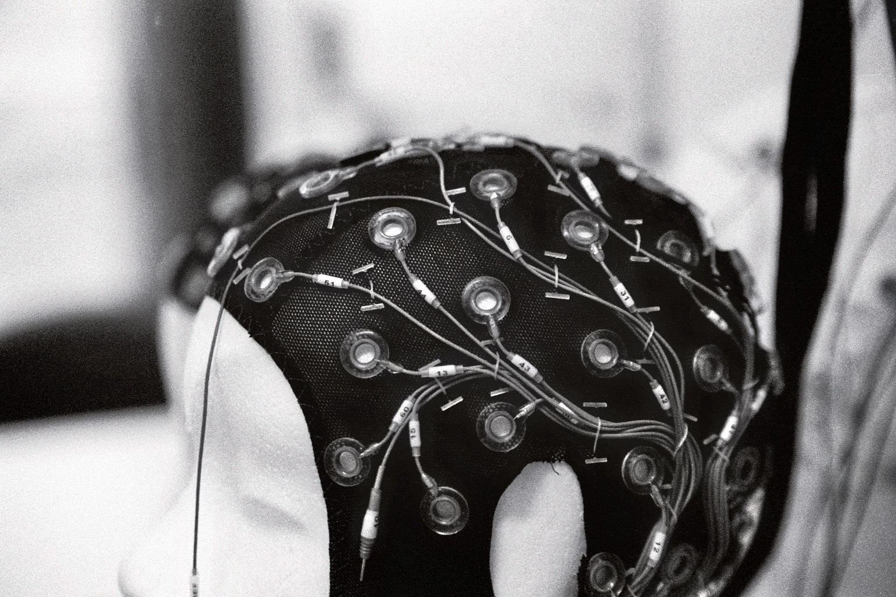

::: {.hero}
[Julius Welzel · Cognitive neuroscientist]{.kicker}

# How the brain keeps us moving {.unlisted}

[I study movement and its disorders with mobile EEG, wearable sensors and open, reproducible methods, in the lab and out in the world.]{.dek}
:::

::: {.hero-figure .reveal}
{fig-alt="Black-and-white photograph of an EEG cap with electrodes and cables on a mannequin head"}
:::

::: {.home-grid}
::: {.dropcap}
I am a cognitive neuroscientist in the [Neuropsychology Lab](https://uol.de/en/neuropsychologie) of Stefan Debener at the University of Oldenburg, and I remain closely connected to Walter Maetzler's Neurogeriatrics group at Kiel University. My research asks how the brain controls movement, and what changes in movement disorders such as Parkinson's disease and essential tremor.

Much of this work happens outside the classic laboratory. I record EEG while people walk, combine it with motion capture and wearable sensors, and build the tools and data standards, such as [Motion-BIDS](software/index.qmd#bids) and [KielMAT](software/index.qmd#kielmat), that make these recordings comparable across labs. More and more, I also study the research process itself: how analysis choices and reporting shape what we find with mobile EEG, and how a research community can make its work more open.

If you are a scientist who would like to collaborate, or a student looking for a thesis project, please [get in touch](mailto:julius.welzel@gmail.com).
:::

::: {.aside-card}
[Currently]{.label}

Neuropsychology Lab, University of Oldenburg · Neurogeriatrics, Kiel University

[Working on]{.label}

- [StepuP](projects/stepup.qmd): treadmill training in Parkinson's disease
- [META-REP](projects/meta-rep.qmd): a reporting standard for mobile EEG
- [Foot placement](projects/foot-placement.qmd): Bayesian control of walking
- [IGOR](projects/igor.qmd): open science in biological psychology

[Elsewhere]{.label}

[GitHub](https://github.com/JuliusWelzel) · [Google Scholar](https://scholar.google.com/citations?user=CWxKXBcAAAAJ) · [ORCID](https://orcid.org/0000-0001-8958-0934) · [Mastodon](https://mastodon.online/@JuliusWelzel)
:::
:::

## Projects

::: {.card-grid}
::: {.project-card}
[Parkinson's disease · Mobile EEG]{.kicker}

### [StepuP](projects/stepup.qmd){.stretched}

A six-country trial asking why treadmill training improves walking in Parkinson's disease, from the cortex down to the foot.

[JPND · 2023–2026]{.card-meta}
:::

::: {.project-card}
[Meta-science · Mobile EEG]{.kicker}

### [META-REP](projects/meta-rep.qmd){.stretched}

Making mobile EEG replicable, with a reporting standard as the cornerstone.

[DFG · SPP 2317]{.card-meta}
:::

::: {.project-card}
[Gait · Modelling]{.kicker}

### [Where to put the next foot](projects/foot-placement.qmd){.stretched}

Bayesian integration in foot placement control, with Moira van Leeuwen and the Amsterdam group.

[VU Amsterdam · ongoing]{.card-meta}
:::

::: {.project-card}
[Open science · Community]{.kicker}

### [IGOR](projects/igor.qmd){.stretched}

The open-science interest group of the DGPs section Biological Psychology and Neuropsychology.

[DGPs · since 2020]{.card-meta}
:::
:::

[All projects →](projects/index.qmd){.section-link}

## Recent publications



[All publications →](publications/index.qmd){.section-link}
