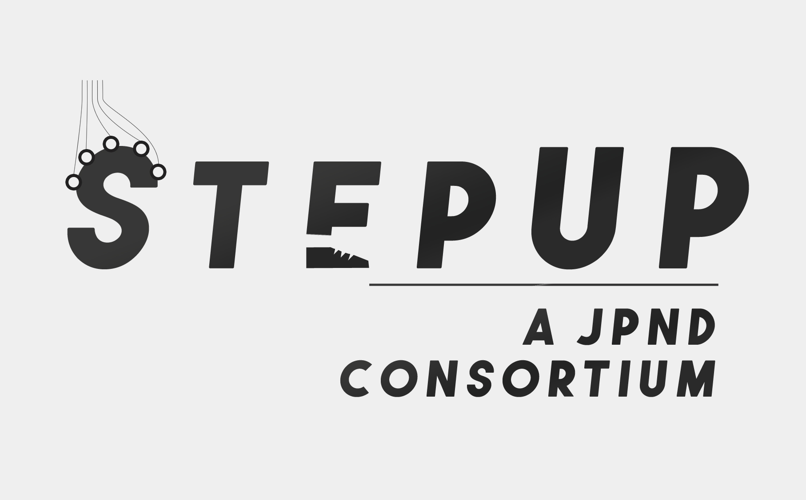

::: {.hero}
[Project · Parkinson's disease · Mobile EEG]{.kicker}

# StepuP {.unlisted}

[Treadmill training helps people with Parkinson's disease walk better. StepuP asks *why*, by recording the brain, the muscles and every step together.]{.dek}
:::

::: {.facts .facts-group}
::: {}
[Funding]{.label}
[EU Joint Programme – Neurodegenerative Disease Research (JPND), JPND2022-128](https://neurodegenerationresearch.eu/)
:::
::: {}
[Period]{.label}
2023 – 2026
:::
::: {}
[Consortium]{.label}
Six partners in the Netherlands, Germany, Italy, Israel, Australia and Switzerland, coordinated by Jaap van Dieën (VU Amsterdam)
:::
::: {}
[My role]{.label}
Kiel site lead with Walter Maetzler; multimodal recording and data standards for the consortium; shared first author of the protocol
:::
:::



## The question

Speed-dependent treadmill training improves gait in Parkinson's disease, but nobody knows the mechanism. StepuP tests two candidate explanations. The first is that training sharpens *stability-related foot placement*, the step-by-step adjustment of where the foot lands relative to the body's centre of mass. The second is that it strengthens *cortical sensorimotor integration*, visible as lower gait-related EEG beta power and higher EEG–EMG (corticomuscular) coherence. A second question is whether a richer training regime (SDTT+, with virtual reality or mechanical perturbations) works better, and whether the gains carry over into walking in daily life.

::: {.pullquote}
Speed-dependent treadmill training helps. StepuP is designed to find out how, from the cortex down to the foot.
:::

## Design

StepuP consists of three harmonised, parallel randomised controlled trials that share one core protocol and run at clinical sites in Kiel, Bologna, Tel Aviv and Sydney. Each trial includes 42 people with Parkinson's disease, so 126 in total. A reference group of 21 healthy older adults is measured in Amsterdam. Participants are randomised to standard speed-dependent treadmill training (SDTT) or to SDTT+, and complete twelve 30-minute training sessions. Depending on the site, SDTT+ adds virtual-reality obstacles, mechanical belt perturbations, or both.

Assessments take place at baseline, right after training and at a 12-week follow-up. Each one combines:

- **Synchronised 64-channel EEG, EMG and 3D motion capture** during treadmill walking at comfortable and fixed speeds, plus resting-state EEG
- **Clinical testing**, e.g. MDS-UPDRS III, Mini-BESTest, MoCA, Trail Making Test, Timed Up and Go, falls self-efficacy and quality of life
- **A week of daily-life monitoring** with a lower-back motion sensor, which yields real-world digital mobility outcomes

The primary clinical endpoint is comfortable overground walking speed. Mechanistic outcomes include stride length and stride time, the explained variance and error of a foot-placement model, EEG beta power and corticomuscular coherence. They are analysed with linear mixed-effects models.

## Data that travel well

A multicentre study with different EEG, EMG and motion-capture systems at every site only works if the data line up. All sites stream and time-lock their devices with the open-source [Lab Streaming Layer](https://labstreaminglayer.org). The recordings are then converted into one multi-site dataset in the [Brain Imaging Data Structure (BIDS)](https://bids.neuroimaging.io), with `eeg`, `emg` and `motion` data for every participant and session. This is where [Motion-BIDS](../software/index.qmd#bids) proves itself in practice.

## My role

Together with Walter Maetzler, I lead StepuP at the Kiel site (University Hospital Schleswig-Holstein and Kiel University), where we supervise the team running the EEG, EMG, motion-capture and training sessions. Across the consortium I am responsible for the multimodal recording and data-standardisation pipeline:

- the [LSL synchronisation setup](https://github.com/JuliusWelzel/StepuP_setup) for the EEG, EMG and motion-capture systems used at the sites
- the [EEG data-quality checks](https://github.com/StepuP-consortium/check_eeg_data)
- the [StepuP BIDS converter](https://github.com/StepuP-consortium/stepup_bids_converter), which turns every site's recordings and REDCap clinical data into one shared dataset
- EEG and BIDS training sessions at consortium meetings

With Moira van Leeuwen, I am shared first author of the StepuP protocol paper.

## Publications



## Links

- Trial registrations on ClinicalTrials.gov: [NCT07057219](https://clinicaltrials.gov/study/NCT07057219), [NCT07058285](https://clinicaltrials.gov/study/NCT07058285) (Kiel) and [NCT07105787](https://clinicaltrials.gov/study/NCT07105787) (Tel Aviv / Bologna)
- [JPND project page](https://www.era-learn.eu/network-information/networks/jpnd/understanding-the-mechanisms-of-non-pharmacological-interventions/steps-against-the-burden-of-parkinson2019s-disease)
- [StepuP consortium on GitHub](https://github.com/StepuP-consortium)

::: {.logo-strip}
{fig-alt="StepuP logo: a JPND consortium"}
:::
