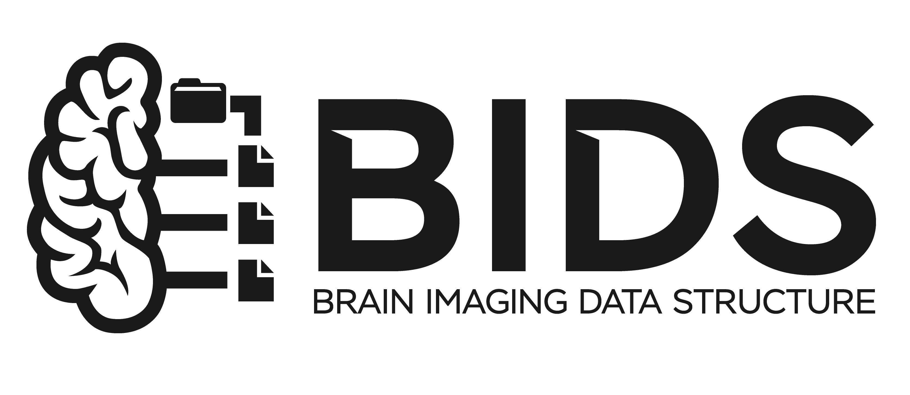

::: {.hero}
[Software & standards]{.kicker}

# Tools that make data travel {.unlisted}

[Data standards and open-source software for mobile EEG, motion and clinical data, so that recordings from different labs can be compared, shared and reused.]{.dek}
:::

## BIDS & Motion-BIDS {#bids}

{width=40% fig-alt="The BIDS logo."}

The [Brain Imaging Data Structure (BIDS)](https://bids.neuroimaging.io) is the community standard for organising neuroscience data. I co-led the extension for motion data, [Motion-BIDS](https://bids-specification.readthedocs.io/en/stable/modality-specific-files/motion.html) (BEP029), which covers optical motion capture, inertial sensors and other tracking systems. Today I contribute to the specification and teach BIDS in workshops and in the [IGOR BIDS Consultation Hour](../projects/igor.qmd).

[*motionbids*](https://github.com/JuliusWelzel/motionbids) is a lightweight Python package I develop for curating motion datasets in the Motion-BIDS format ([documentation](https://juliuswelzel.github.io/motionbids/), [PyPI](https://pypi.org/project/motionbids/)).

My role: co-lead author of Motion-BIDS; developer of *motionbids*

Links:
[Specification](https://bids-specification.readthedocs.io/en/stable/modality-specific-files/motion.html) ·
[Paper](https://doi.org/10.1038/s41597-024-03559-8) ·
[Teaching materials](https://github.com/JuliusWelzel/motion_bids_materials_jw)

## KielMAT {#kielmat}

{width=25% fig-alt="The Neurogeriatrics Kiel logo."}

The [Kiel Motion Analysis Toolbox (KielMAT)](https://neurogeriatricskiel.github.io/KielMAT/), formerly NGMT, is an open-source Python toolbox for gait and balance analysis in neurological cohorts. It runs validated algorithms on wearable and motion-capture data, and its data model is built around Motion-BIDS.

My role: co-developer and co-maintainer

Links:
[Documentation](https://neurogeriatricskiel.github.io/KielMAT/) ·
[GitHub](https://github.com/neurogeriatricskiel/KielMAT) ·
[PyPI](https://pypi.org/project/kielmat/) ·
[JOSS paper](https://doi.org/10.21105/joss.06842)

## UNISEP {#unisep}

UNISEP is a unified, modality-agnostic framework for describing where sensors are placed on the human body in motion capture and wearable research. Its vocabulary is used, for example, in the data curation of [EEGManySteps](../projects/eegmanysteps.qmd).

My role: co-first author

Links:
[Preprint](https://arxiv.org/abs/2412.21159) ·
[GitHub](https://github.com/unisep-framework/unisep-framework.github.io)

## REDCap workflows {#redcap}

Two Python packages that bring clinical and questionnaire data into reproducible pipelines:

- [*rcol*](https://github.com/JuliusWelzel/rcol) installs standardised questionnaire and test instruments into REDCap projects ([documentation](https://juliuswelzel.github.io/rcol/), [PyPI](https://pypi.org/project/rcol/)).
- [*redcap2bids*](https://github.com/JuliusWelzel/redcap2bids) turns REDCap exports into BIDS participant files.

My role: developer

## Multimodal recording {#lsl}

Tools for synchronised recordings with the [Lab Streaming Layer (LSL)](https://labstreaminglayer.org) and for multi-site data harmonisation, developed for [StepuP](../projects/stepup.qmd):

- [StepuP setup](https://github.com/JuliusWelzel/StepuP_setup): LSL synchronisation of EEG, EMG and motion-capture systems
- [StepuP BIDS converter](https://github.com/StepuP-consortium/stepup_bids_converter): one BIDS dataset from every site's EEG, EMG, motion and REDCap data
- [EEG data checks](https://github.com/StepuP-consortium/check_eeg_data): quality checks for incoming EEG recordings

My role: developer
