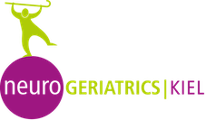

::: {.hero}
[Software]{.kicker}

# Software {.unlisted}

[Published open-source Python packages for the analysis and management of motion and clinical research data.]{.dek}
:::

## KielMAT {#kielmat}

{width=25% fig-alt="The Neurogeriatrics Kiel logo."}

The Kiel Motion Analysis Toolbox (KielMAT, formerly NGMT) is a Python toolbox for gait and balance analysis in neurological cohorts. It implements validated algorithms for wearable and motion-capture data and uses a data model based on Motion-BIDS.

Role: co-developer and co-maintainer

[Documentation](https://neurogeriatricskiel.github.io/KielMAT/) ·
[PyPI](https://pypi.org/project/kielmat/) ·
[GitHub](https://github.com/neurogeriatricskiel/KielMAT) ·
[JOSS paper](https://doi.org/10.21105/joss.06842)

## motionbids {#motionbids}

A lightweight Python package for converting motion data (optical motion capture, inertial sensors) to the [Motion-BIDS](https://bids-specification.readthedocs.io/en/stable/modality-specific-files/motion.html) format.

Role: developer

[Documentation](https://juliuswelzel.github.io/motionbids/) ·
[PyPI](https://pypi.org/project/motionbids/) ·
[GitHub](https://github.com/JuliusWelzel/motionbids)

## rcol {#rcol}

A Python package with templates for standardised questionnaires and clinical tests in REDCap, including stacking and upload of instrument data.

Role: developer

[Documentation](https://juliuswelzel.github.io/rcol/) ·
[PyPI](https://pypi.org/project/rcol/) ·
[GitHub](https://github.com/JuliusWelzel/rcol)
